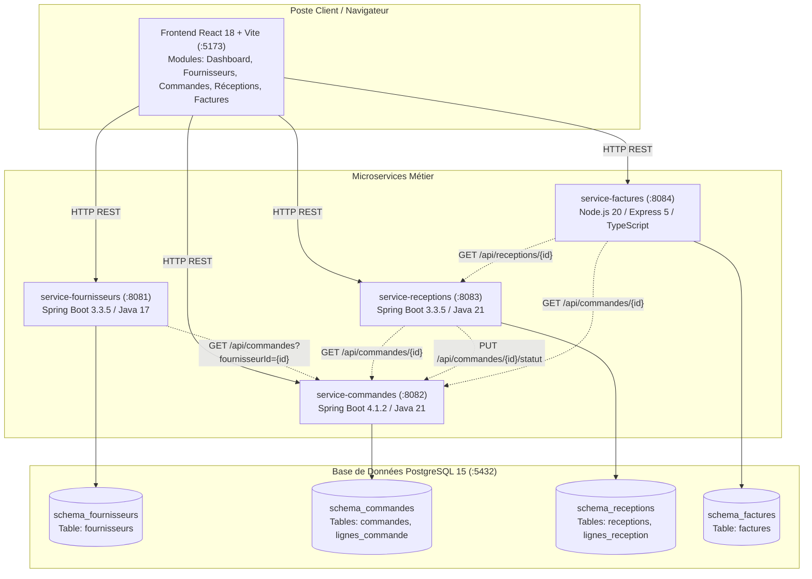

# Rapport Source du Projet ProcuraFlow
*Document de référence technique et académique — Module Qualité Logicielle & Web Services*  
*Dépôt officiel : [https://github.com/mohamedbailla599/ProcuraFlow](https://github.com/mohamedbailla599/ProcuraFlow)*  
*Branche de référence : `test-merge`*

---

# 1. Présentation du projet

**ProcuraFlow** est une plateforme distribuée de gestion et de dématérialisation du cycle d'achat universitaire (Procure-to-Pay / P2P). Son périmètre couvre l'intégralité de la chaîne d'approvisionnement : référencement des fournisseurs, émission et suivi des bons de commande, enregistrement et contrôle quantitatif des livraisons physiques, et rapprochement tripartite (3-Way Matching) préalable au paiement des factures.

Les acteurs du système sont les acheteurs universitaires (gestionnaires de crédits, directeurs de laboratoires), les magasiniers (agents de réception sur campus) et les gestionnaires comptables et financiers.

---

# 2. Équipe et répartition

L'analyse de l'historique Git (`git shortlog -sn --all`) et des répertoires du dépôt établit la répartition et les responsabilités réelles suivantes :

| Membre | Rôle & Service | Port | Commits Git | Fichiers principaux & Responsabilités réelles vérifiées |
|---|---|:---:|:---:|---|
| **Mohamed Bailla** | Référentiel Fournisseurs & Frontend Global | `:8081`<br/>`:5173` | **72** | `service-fournisseurs-mohamed/`, `frontend/`, `docker-compose.yml`. Développement du microservice Fournisseurs (API, DTO, validation, tests, exports, recherche multi-critères, soft/hard delete), du portail Frontend unifié React, des modules de navigation et du Dashboard décisionnel 360°. |
| **Yassine Meskaoui** | Chef de projet & Service Commandes | `:8082` | **35** | `service-commandes-yassine/`. Développement du microservice Commandes (Spring Boot), gestion des bons de commande (`Commande`), des lignes d'articles (`LigneCommande`), calcul des montants et transitions de statuts. |
| **Ali Halla** | Service Réceptions | `:8083` | **6** | `service-receptions-ali/`. Développement du microservice Réceptions (Spring Boot), gestion des bons de livraison (`Reception`, `LigneReception`), calcul des reliquats de commande (`/soldes`), verrouillage transactionnel PostgreSQL et idempotence via UUID. |
| **Hamza Ait Benayad** | Service Factures | `:8084` | **14** | `service-factures-hamza/`. Développement du microservice Factures (Node.js/TypeScript/Express/Drizzle), règles de rapprochement 3-voies (validation commande + réception conforme), cycle de paiement et suite de tests automatisés Jest. |

---

# 3. Architecture

## 3.1. Schéma d'Architecture Globale



## 3.2. Stack Technique Réelle par Composant

Les versions exactes relevées dans les fichiers de configuration sont :

| Composant | Langage & Runtime | Framework principal | Dépendances & Outils clés vérifiés |
|---|---|---|---|
| **Fournisseurs** | Java 17 / JVM 21 | Spring Boot `3.3.5` | Spring Data JPA, Hibernate `6.5.3`, PostgreSQL JDBC, Springdoc OpenAPI `2.6.0`, Actuator, JUnit 5, H2 Database `2.2.224`, Testcontainers. |
| **Commandes** | Java 21 | Spring Boot `4.1.2` (parent) | Spring Data JPA, Hibernate `7.4.13`, PostgreSQL JDBC, Lombok, JUnit 5, Mockito. |
| **Réceptions** | Java 21 | Spring Boot `3.3.5` | Spring Data JPA, Flyway Core + Flyway PostgreSQL `10.11.1`, PostgreSQL JDBC. |
| **Factures** | TypeScript `6.0.3` / Node.js 20 | Express `5.3.0` | Drizzle ORM `0.45.4`, `pg` `8.23.1`, Zod `4.6.7`, Axios `1.21.0`, Jest `30.5.2`, Supertest `7.3.2`. |
| **Frontend** | TypeScript `5.7.2` / Node.js 20 | React `18.3.1` + Vite `6.0.7` | React Router `7.18.5`, Tailwind CSS `3.4.17`, Lucide React `0.468.0`, Leaflet `1.9.4`, jsPDF `4.2.1`, XLSX `0.18.5`. |
| **Base de Données** | SQL / PL-pgSQL | PostgreSQL 15-alpine | Schémas isolés, contraintes d'unicité, verrous consultatifs (`pg_advisory_xact_lock`). |

## 3.3. Base de Données

Le fichier `database/init.sql` crée l'instance `db_achats_univ` et 4 schémas étanches.

- **`schema_fournisseurs.fournisseurs`** : `id` (BIGINT identity PK), `nom` (VARCHAR 150 NOT NULL), `email` (VARCHAR 150 UNIQUE NOT NULL), `telephone` (VARCHAR 30), `adresse` (TEXT), `actif` (BOOLEAN DEFAULT TRUE), `created_at` (TIMESTAMPTZ), `updated_at` (TIMESTAMPTZ).
- **`schema_commandes.commandes`** : `id` (SERIAL PK), `fournisseur_id` (INT NOT NULL), `date_commande` (TIMESTAMP DEFAULT NOW()), `statut` (VARCHAR 30 DEFAULT 'EN_ATTENTE'), `montant_total` (DECIMAL 10,2 NOT NULL).
- **`schema_commandes.lignes_commande`** : `id` (SERIAL PK), `commande_id` (INT REFERENCES commandes ON DELETE CASCADE), `designation` (VARCHAR 150 NOT NULL), `quantite` (INT NOT NULL), `prix_unitaire` (DECIMAL 10,2 NOT NULL).
- **`schema_receptions.receptions`** : `id` (SERIAL PK), `commande_id` (INT NOT NULL), `date_reception` (TIMESTAMP DEFAULT NOW()), `remarques` (TEXT), `statut_reception` (VARCHAR 30 DEFAULT 'CONFORME'), `cle_creation` (UUID UNIQUE).
- **`schema_receptions.lignes_reception`** : `id` (BIGINT identity PK), `reception_id` (BIGINT REFERENCES receptions ON DELETE CASCADE), `ligne_commande_id` (BIGINT NOT NULL), `quantite_recue` (INTEGER NOT NULL CHECK > 0), `remarques` (TEXT), contrainte UNIQUE `(reception_id, ligne_commande_id)`.
- **`schema_factures.factures`** : `id` (BIGINT identity PK), `numero_facture` (VARCHAR 50 UNIQUE), `commande_id` (BIGINT NOT NULL), `reception_id` (BIGINT NOT NULL), `date_facture` (TIMESTAMPTZ DEFAULT NOW()), `montant_facture` (NUMERIC 12,2 NOT NULL), `statut_paiement` (VARCHAR 30 DEFAULT 'NON_PAYEE'), `created_at` (TIMESTAMPTZ), `updated_at` (TIMESTAMPTZ).

*Remarque d'intégrité* : Il n'y a aucune clé étrangère inter-schémas en base de données. L'association entre microservices s'effectue par identifiant logique et appels HTTP REST.

## 3.4. Orchestration Docker

Le fichier `docker-compose.yml` définit 6 services connectés sur le bridge `reseau-achats` avec un volume persistant `pg_data` :
- `postgres-db` (:5432) : Base PostgreSQL initialisée via `./database/init.sql`. Healthcheck `pg_isready`.
- `service-fournisseurs` (:8081) : Construit depuis `./service-fournisseurs-mohamed`. Dépend de `postgres-db`.
- `service-commandes` (:8082) : Construit depuis `./service-commandes-yassine/service-commandes`. Dépend de `postgres-db`.
- `service-receptions` (:8083) : Construit depuis `./service-receptions-ali`. Dépend de `postgres-db` et `service-commandes`.
- `service-factures` (:8084) : Construit depuis `./service-factures-hamza`. Dépend de `postgres-db` et `service-commandes`.
- `frontend` (:5173 -> :80) : Construit depuis `./frontend` (Nginx servant le bundle de production Vite).

## 3.5. Écarts entre le Cahier des Charges et l'Implémentation Réelle

1. **ORM du Service Factures** : Le `README.md` initial prévoyait « Prisma ou TypeORM ». L'implémentation effective utilise **Drizzle ORM (`drizzle-orm`)** couplé au pool PostgreSQL standard `pg`.
2. **Absence d'API Gateway centralisée** : Le projet ne dispose pas d'un service de routage Spring Cloud Gateway ou Kong. Chaque microservice expose son propre port sur l'hôte (`8081` à `8084`). En développement local, le serveur Vite (`vite.config.ts`) fait office de proxy inverse ; en conteneur Docker, Nginx redirige les requêtes.
3. **Absence de validation synchrone dans Commandes** : Le service Commandes ne vérifie pas auprès du service Fournisseurs l'existence de l'identifiant `fournisseurId` lors de la création d'un bon de commande (`POST /api/commandes`).

---

# 4. Fonctionnalités par service

## 4.1. Service Fournisseurs (`service-fournisseurs-mohamed` — Port 8081)

### Endpoints REST vérifiés
| Méthode | Route | Rôle | Codes HTTP |
|---|---|---|:---:|
| `POST` | `/api/fournisseurs` | Créer un fournisseur (actif par défaut) | 201, 400, 409 |
| `GET` | `/api/fournisseurs` | Liste filtrée/triée (sans pagination ou avec `?page=&size=`) | 200, 400 |
| `GET` | `/api/fournisseurs/stats` | Indicateurs globaux (total, actifs, inactifs, villes) | 200 |
| `GET` | `/api/fournisseurs/{id}` | Consulter un fournisseur par ID | 200, 404, 400 |
| `PUT` | `/api/fournisseurs/{id}` | Mettre à jour informations (nom, email, téléphone, adresse) | 200, 400, 404, 409 |
| `PATCH` | `/api/fournisseurs/{id}/desactiver` | Désactivation logique (`actif = false`) | 200, 404 |
| `PATCH` | `/api/fournisseurs/{id}/reactiver` | Réactivation logique (`actif = true`) | 200, 404 |
| `DELETE` | `/api/fournisseurs/{id}` | Désactivation logique par défaut (204). Suppression physique si `?permanent=true` ou `?force=true` | 204, 404 |
| `POST` | `/api/fournisseurs/bulk-delete` | Suppression groupée exceptionnelle (`permanent=true`) ou désactivation en masse | 204 |
| `GET` | `/api/fournisseurs/{id}/commandes` | Historique des commandes du fournisseur (via appel HTTP vers `:8082`) | 200, 404, 502, 503 |
| `GET` | `/actuator/health` | Diagnostic de santé Spring Boot Actuator | 200 |

### Règles métier codées
- Unicité stricte de l'adresse email normalisée (`lowercase`), insensible à la casse.
- Validation des champs obligatoires (`nom` non vide, `email` valide).
- Préservation de la piste d'audit : par défaut, la suppression est logique (`actif = false`). La suppression physique est protégée par un paramètre explicite (`permanent=true`).
- Recherche textuelle insensible aux accents (`foldAccents`) et variantes toponymiques des villes marocaines (`CITY_VARIANTS`).

---

## 4.2. Service Commandes (`service-commandes-yassine` — Port 8082)

### Endpoints REST vérifiés
| Méthode | Route | Rôle | Codes HTTP |
|---|---|---|:---:|
| `GET` | `/api/commandes` | Liste de toutes les commandes (filtrable par `?fournisseurId=`) | 200 |
| `GET` | `/api/commandes/{id}` | Détail d'une commande avec ses lignes | 200, 404 |
| `GET` | `/api/commandes/fournisseur/{fournisseurId}` | Commandes associées à un fournisseur | 200 |
| `POST` | `/api/commandes` | Création d'une commande avec initialisation du statut | 200, 400 |
| `PUT` | `/api/commandes/{id}` | Modification complète (fournisseur, statut, lignes) | 200, 404 |
| `PUT` | `/api/commandes/{id}/statut` | Mise à jour du statut (`?statut=...`) | 200, 400, 404 |
| `DELETE` | `/api/commandes/{id}` | Suppression physique d'une commande et de ses lignes (CASCADE) | 204, 404 |

### Règles métier codées
- Énumération des statuts (`StatutCommande`) : `EN_ATTENTE`, `VALIDEE`, `EN_COURS`, `LIVREE`, `ANNULEE`.
- Statut initial par défaut : `EN_ATTENTE` lors de la création si non précisé.
- Rattachement bidirectionnel JPA obligatoire entre `Commande` et ses `LigneCommande` lors de la persistance.

---

## 4.3. Service Réceptions (`service-receptions-ali` — Port 8083)

### Endpoints REST vérifiés
| Méthode | Route | Rôle | Codes HTTP |
|---|---|---|:---:|
| `GET` | `/api/receptions` | Liste chronologique des réceptions (filtrable par `?commandeId=`) | 200 |
| `GET` | `/api/receptions` (avec pagination) | Pagination (`?page=0&size=10`) | 200, 400 |
| `GET` | `/api/receptions/{id}` | Consultation d'un bon de réception par son ID | 200, 404 |
| `GET` | `/api/receptions/commandes/{id}/soldes` | Calcul des quantités restantes à livrer par ligne de commande | 200, 400, 404, 409, 502, 503 |
| `POST` | `/api/receptions` | Enregistrement transactionnel d'une livraison | 201, 200 (idempotent), 400, 409, 502, 503 |

### Règles métier codées
- Idempotence garantie par UUID client (`cleCreation`) : un deuxième envoi avec la même clé et le même contenu retourne le bon existant (HTTP 200).
- Verrou transactionnel PostgreSQL (`pg_advisory_xact_lock`) sérialisant les écritures concurrentes sur la même commande.
- Interdiction de sur-réception : la quantité reçue ne peut excéder le solde restant (`quantiteCommandee - dejaRecu`).
- Mise à jour automatique de la commande : si l'intégralité des lignes est reçue, appel sortant vers `:8082` pour basculer le statut en `LIVREE` ; sinon, bascule en `EN_COURS`.

---

## 4.4. Service Factures (`service-factures-hamza` — Port 8084)

### Endpoints REST vérifiés
| Méthode | Route | Rôle | Codes HTTP |
|---|---|---|:---:|
| `GET` | `/api/factures` | Liste de toutes les factures | 200 |
| `GET` | `/api/factures/{id}` | Consultation d'une facture par son ID | 200, 400, 404 |
| `POST` | `/api/factures` | Création d'une facture après rapprochement 3-voies | 201, 400, 409, 503 |
| `PUT` | `/api/factures/{id}` | Modification d'une facture (uniquement si NON_PAYEE) | 200, 400, 404, 409 |
| `PATCH` | `/api/factures/{id}/paiement` | Mise à jour du statut de paiement | 200, 400, 404, 409 |
| `DELETE` | `/api/factures/{id}` | Suppression physique (si NON_PAYEE) ou annulation comptable (si PAYEE) | 204, 400, 404 |
| `GET` | `/api/health` | Contrôle de santé du service | 200 |

### Règles métier codées
- Rapprochement 3-voies obligatoire : vérification de la commande (doit être `VALIDEE` ou `LIVREE`) et de la réception (doit être `CONFORME` et liée à cette commande).
- Unicité de facturation : interdiction de créer deux factures actives pour le même bon de commande (HTTP 409).
- Machine à états de paiement (`TRANSITIONS_AUTORISEES`) :
  - `NON_PAYEE` → autorisée vers `PAYEE` ou `ANNULEE`.
  - `PAYEE` → état terminal (aucune transition autorisée).
  - `ANNULEE` → état terminal (aucune transition autorisée).
- Règle comptable de suppression : une facture payée ne peut être physiquement détruite ; l'appel `DELETE` la passe automatiquement en statut `ANNULEE`.

---

# 5. Communication entre services

L'ensemble des interactions synchrones inter-services relevées dans le code est résumé ci-dessous :

```
[service-fournisseurs] ──── (1) GET /api/commandes?fournisseurId={id} ───> [service-commandes]
[service-receptions]   ──── (2) GET /api/commandes/{id} ─────────────────> [service-commandes]
[service-receptions]   ──── (3) PUT /api/commandes/{id}/statut ──────────> [service-commandes]
[service-factures]     ──── (4) GET /api/commandes/{id} ─────────────────> [service-commandes]
[service-factures]     ──── (5) GET /api/receptions/{id} ────────────────> [service-receptions]
```

### Détail des comportements en cas de panne ou indisponibilité

1. **Fournisseurs → Commandes (`CommandesClient.java`)** :
   - Timeout réseau ou service éteint (`ResourceAccessException`) : capture l'exception et lève une `DownstreamServiceUnavailableException` (traduite en **HTTP 503 Service Unavailable** par le `GlobalExceptionHandler`).
   - Code HTTP 404 retourné par Commandes : interprété normalement comme une absence de commandes pour ce fournisseur (retourne une liste vide `[]`).
   - Erreur 5xx ou JSON inexploitable : lève `DownstreamBadGatewayException` (**HTTP 502 Bad Gateway**).

2. **Réceptions → Commandes (`CommandesClient.java`)** :
   - Timeouts configurés : connexion 3000 ms, lecture 5000 ms via `SimpleClientHttpRequestFactory`.
   - Panne ou timeout : converti en `ResponseStatusException` avec code **HTTP 503**.
   - Lors de la mise à jour de statut (`PUT /api/commandes/{id}/statut`) : encapsulé dans un bloc `try / catch (Exception)` qui consigne un avertissement dans les logs sans annuler la transaction de réception (tolérance aux pannes).

3. **Factures → Commandes & Réceptions (`commande.client.ts` & `reception.client.ts`)** :
   - Timeout Axios configuré via variable d'environnement (`REQUEST_TIMEOUT`, 5000 ms par défaut).
   - En cas d'échec de connexion (`error.request` sans réponse) : lève `ApiError.serviceUnavailable` (**HTTP 503** avec message explicite sur le microservice tiers en panne).
   - Si la ressource est absente côté tiers (404) : converti en **HTTP 400 Bad Request** pour le client de Factures (rejet de la création de facture).

4. **Résilience et Circuit Breaker** :
   - Aucun circuit breaker automatisé (de type Resilience4j ou Hystrix) n'est implémenté dans les services Java ou Node.js.
   - Aucun mécanisme de rejeu automatique (retry) avec backoff exponentiel n'est actif.

---

# 6. Workflow Procure-to-Pay (P2P)

Le scénario complet de bout en bout fonctionne selon les 4 étapes suivantes :

### Étape 1 : Référencement du Fournisseur
- **Action** : Création du fournisseur via le formulaire frontend ou l'import CSV/Excel (`POST /api/fournisseurs`).
- **Mode** : Manuel (utilisateur).
- **Vérification** : Contrôle d'unicité de l'email, validation de l'adresse et statut initial `Actif`.

### Étape 2 : Émission du Bon de Commande (BC)
- **Action** : L'acheteur sélectionne un fournisseur et saisit les lignes d'achat (`POST /api/commandes`).
- **Mode** : Manuel (utilisateur).
- **Statut initial** : `EN_ATTENTE`.
- **Validation** : Le statut peut être avancé manuellement vers `VALIDEE` via l'interface ou l'API (`PUT /api/commandes/{id}/statut?statut=VALIDEE`).

### Étape 3 : Réception physique & Contrôle de livraison (BL)
- **Action** : À la livraison sur campus, le magasinier ouvre la commande et consulte les quantités restantes (`GET /api/receptions/commandes/{id}/soldes`).
- **Mode** : Saisie manuelle des quantités reçues avec génération automatique d'une clé d'idempotence UUID (`POST /api/receptions`).
- **Vérification** : Contrôle strict de non-dépassement des quantités commandées.
- **Automatisation** : Si toutes les lignes atteignent le solde commandé, le microservice Réceptions appelle automatiquement Commandes pour basculer le statut vers **`LIVREE`** (sinon **`EN_COURS`**).

### Étape 4 : Rapprochement 3-voies & Règlement de la Facture
- **Action** : Le gestionnaire comptable crée la facture (`POST /api/factures`) en sélectionnant la commande et le bon de réception.
- **Règle exacte du 3-Way Matching codée** :
  1. La commande existe et a pour statut `VALIDEE` ou `LIVREE`.
  2. La réception existe, a pour statut `CONFORME`, et référence exactement ce `commande_id`.
  3. Aucune autre facture active n'est enregistrée pour cette commande.
- **Règlement** : Le gestionnaire valide le paiement (`PATCH /api/factures/{id}/paiement` avec `PAYEE`).
- **Impact visuel** : Le frontend répercute immédiatement le statut payé par des badges verts avec coche et synchronise les synthèses financières.

---

# 7. Frontend

Le frontend est une Single Page Application (SPA) développée en **React 18.3.1**, **TypeScript 5.7.2** et packagée par **Vite 6.0.7**.

### Pages réellement présentes dans le code
1. **`/dashboard` (`DashboardPage.tsx`)** :
   - 4 cartes KPI exécutives : Budget total engagé (MAD), Commandes actives, Fournisseurs actifs, Factures payées vs non payées.
   - Entonnoir de conversion interactif (Pipeline du cycle d'achat Fournisseurs → BC → BL → Factures).
   - Graphique Donut de répartition des statuts de commandes (avec sélecteur Tous/Actifs).
   - Graphique Bar Chart horizontal des Top Fournisseurs par volume financier.
   - Journal d'Activité en Temps Réel en pleine largeur avec recherche instantanée, filtres de flux (`Tous`, `Commandes`, `Réceptions`, `Factures`, `Règlements`), pastille dynamique `Flux Actif` et pagination extensible.
2. **`/fournisseurs` (`FournisseursPage.tsx`)** :
   - Triple vue commutable : Tableau entreprise, Grille de cartes visuelles, Carte géographique OpenStreetMap (Leaflet + MarkerCluster).
   - Recherche multi-critères avec temporisation (debounce 250 ms), filtres de statuts et filtres par ville marocaine.
   - Exports de données : export CSV de la sélection ou du catalogue complet, export PDF officiel A4 paysage formaté avec en-tête et statistiques (`jspdf` + `jspdf-autotable`).
   - Import massif de fichiers CSV / Excel (`xlsx`) avec détection automatique des colonnes et des doublons d'emails.
   - Suppression exceptionnelle de fournisseurs sélectionnés avec boîte de dialogue de sécurité (`DeleteSuppliersModal`) et case de confirmation obligatoire.
   - Tiroir latéral (`CommandesDrawer.tsx`) affichant l'historique complet des commandes associées au fournisseur.
3. **`/commandes` (`CommandesPage.tsx`)** :
   - Gestionnaire complet de bons de commande avec formulaires dynamiques de lignes d'articles et calcul automatique du montant HT / TTC.
   - Mise à jour interactive des statuts de commande.
4. **`/receptions` (`ReceptionsPage.tsx`)** :
   - Enregistrement des bons de livraison, consultation des soldes restants en direct, contrôle de conformité.
5. **`/factures` (`FacturesPage.tsx`)** :
   - Formulaire de rapprochement 3-voies, enregistrement des factures, suivi des règlements et génération de facture PDF téléchargeable.

### Fonctionnalités transverses vérifiées
- **Mode Sombre / Mode Clair (`ThemeContext.tsx`)** : Bascule dynamique avec persistance en `localStorage`.
- **Mode Démo (`AppContext.tsx`)** : Permet de manipuler l'ensemble des écrans avec un jeu de données simulant les 4 services, même si les microservices backend sont éteints.
- **Palette de commandes globale (`CommandPalette.tsx`)** : Raccourci clavier universel `Ctrl+K` / `Cmd+K` pour naviguer et exécuter des actions instantanément.

---

# 8. Tests et qualité

## 8.1. Résultats d'Exécution Réelle des Tests

L'ensemble des suites de tests automatisées présentes dans le dépôt a été exécuté. Les résultats bruts obtenus sont les suivants :

| Service | Framework de test | Commande d'exécution | Suites / Fichiers | Tests exécutés | Réussis | Échecs |
|---|---|---|---|:---:|:---:|:---:|
| **Fournisseurs** | JUnit 5 / Spring Test / MockMvc | `mvn test` (via conteneur Maven) | 6 classes de test | **56** | **56** | **0** |
| **Commandes** | JUnit 5 / Spring Test / MockMvc | `mvn test` (via conteneur Maven) | 3 classes de test | **7** | **7** | **0** |
| **Factures** | Jest 30.5.2 / Supertest 7.3.2 | `npm test` | 3 fichiers (`unit`, `integration`, `recette`) | **50** | **50** | **0** |
| **Réceptions** | *Aucun test unitaire Java* | `mvn test` | 0 classe Java dans `src/test/java` | **0** | **0** | **0** |
| **Frontend** | *Aucun framework de test unitaire* | — | `package.json` ne comporte pas de script test (uniquement build/tsc) | Non testé | — | — |

### Détail des classes de tests vérifiées

- **`service-fournisseurs-mohamed` (56 tests réussis)** :
  - `FournisseurServiceTest` : 14 tests (création, normalisation email, rejet doublons, pagination, soft/hard delete, tri).
  - `FournisseurServiceAtelierTest` : 12 tests (cas limites, filtrage par ville, règles de validation).
  - `FournisseurControllerTest` : Tests unitaires contrôleur MockMvc (endpoints REST, sérialisation JSON).
  - `FournisseurIntegrationTest` : 2 tests d'intégration avec contexte Spring complet et base H2.
  - `CommandesClientTest` : Tests MockRestServiceServer vérifiant la résilience HTTP (503, 502, 404).
  - `NeonJdbcUrlResolverTest` : Tests de résolution d'URL JDBC.

- **`service-commandes-yassine` (7 tests réussis)** :
  - `ServiceCommandesApplicationTests` : 1 test de chargement du contexte Spring Boot.
  - `CommandeServiceTest` : 3 tests unitaires de la couche service.
  - `CommandeControllerTest` : 3 tests MockMvc (`testListerCommandes`, `testObtenirCommandeParId`, `testCreerCommande`).

- **`service-factures-hamza` (50 tests réussis)** :
  - `tests/unit/facture.service.test.ts` : 20 tests (création, statuts, refus si commande non validée/livrée, refus si réception non conforme, gestion des erreurs 503, transitions d'état).
  - `tests/integration/facture.routes.test.ts` : 21 tests d'intégration HTTP Supertest sur les routes Express.
  - `tests/recette.test.ts` : 9 tests fonctionnels validant les 9 exigences du cahier de recette.

- **`service-receptions-ali` (Constat de test)** :
  - Le répertoire `src/test/java` est absent.
  - Un script d'intégration Python `tests/registration.py` est présent à la racine du service. Son exécution contre les services actifs échoue actuellement (5 tests en échec) car il soumet le statut de commande non reconnu `EXPEDIEE` à `service-commandes` (qui n'accepte que `EN_ATTENTE`, `VALIDEE`, `EN_COURS`, `LIVREE`, `ANNULEE`).

## 8.2. Collections Postman

Le dossier `postman/` contient deux fichiers :
- `Local_Environment.json` : Déclare les variables d'environnement (`fournisseurs_url = http://localhost:8081`, `commandes_url = http://localhost:8082`, `receptions_url = http://localhost:8083`, `factures_url = http://localhost:8084`).
- `Collection_Projet_Achats_Univ.json` :
  - Dossier 1 : **Service Fournisseurs (Mohamed - 8081)** : 9 requêtes couvrant création, consultation, filtrage, pagination, modification, désactivation, réactivation, historique des commandes et diagnostic Actuator.
  - Dossier 4 : **Service Factures (Hamza - 8084)** : 8 requêtes couvrant création 3-voies, liste, recherche par ID, mise à jour, paiement et annulation.
  - *Lacune constatée* : Les dossiers 2 (Commandes) et 3 (Réceptions) ne figurent pas dans cette collection partagée.

---

# 9. Déploiement et exécution

### 9.1. Lancement complet via Docker Compose (Recommandé)

À la racine du projet :
```bash
# 1. Cloner le dépôt et se placer à la racine
git clone https://github.com/mohamedbailla599/ProcuraFlow.git
cd ProcuraFlow
git checkout test-merge

# 2. Construire et démarrer l'ensemble des conteneurs
docker compose up --build -d

# 3. Vérifier l'état de tous les conteneurs
docker compose ps
```

### 9.2. Matrice des Ports et URLs d'Accès

| Service | URL d'accès | Rôle / Documentation |
|---|---|---|
| **Portail Frontend Unifié** | `http://localhost:5173` | Interface globale (Dashboard & 4 modules) |
| **API Fournisseurs** | `http://localhost:8081/api/fournisseurs` | Swagger UI : `http://localhost:8081/swagger-ui.html` |
| **API Commandes** | `http://localhost:8082/api/commandes` | Swagger UI : `http://localhost:8082/swagger-ui.html` |
| **API Réceptions** | `http://localhost:8083/api/receptions` | Documentation README |
| **API Factures** | `http://localhost:8084/api/factures` | Health check : `http://localhost:8084/api/health` |
| **Base PostgreSQL** | `localhost:5432` | Base `db_achats_univ`, user `admin_achats` |

---

# 10. Limites et améliorations possibles

1. **Couverture de tests hétérogène** :
   - `service-receptions-ali` ne dispose d'aucun test unitaire JUnit en Java. Son script de test externe Python doit être réaligné sur les statuts réels du service Commandes.
   - Le frontend ne dispose pas de tests unitaires (Vitest / React Testing Library) ni de tests end-to-end (Playwright / Cypress).
2. **Absence de passerelle API (API Gateway)** :
   - L'architecture expose directement 4 ports distincts sur l'hôte au lieu de centraliser l'accès derrière un reverse-proxy unifié unique (ex. Spring Cloud Gateway ou Traefik).
3. **Transactions distribuées et cohérence à terme** :
   - En cas d'échec du service Commandes lors du basculement automatique de statut à la fin d'une livraison, aucune compensation automatique (pattern Saga / outbox table) n'est mise en œuvre.
4. **Validation synchrone des clés étrangères logiques** :
   - Le service Commandes enregistre les commandes sans vérifier au préalable auprès de `:8081` que le fournisseur existe et est à l'état actif.
5. **Gestion de la sécurité et de l'authentification** :
   - Les endpoints ne sont pas protégés par authentification (JWT, OAuth2/OIDC ou Spring Security sont absents).

---

# 11. Annexes

- **Dépôt officiel GitHub** : [https://github.com/mohamedbailla599/ProcuraFlow](https://github.com/mohamedbailla599/ProcuraFlow)
- **Branche active** : `test-merge`

### Arborescence du dépôt (2 niveaux)
```text
ProcuraFlow/
├── database/
│   └── init.sql
├── docs/
│   ├── sfd/
│   │   ├── images/
│   │   └── SFD_ProcuraFlow_Service_Fournisseurs_v2.0.docx
│   ├── charte-graphique-assets.zip
│   ├── charte-graphique-audit.md
│   └── images.zip
├── frontend/
│   ├── src/
│   ├── public/
│   ├── index.html
│   ├── package.json
│   ├── tsconfig.json
│   └── vite.config.ts
├── postman/
│   ├── Collection_Projet_Achats_Univ.json
│   └── Local_Environment.json
├── service-commandes-yassine/
│   ├── service-commandes/
│   │   ├── src/
│   │   ├── pom.xml
│   │   └── Dockerfile
│   ├── README.md
│   └── TEST_REPORT.md
├── service-factures-hamza/
│   ├── src/
│   ├── tests/
│   ├── package.json
│   ├── tsconfig.json
│   ├── Dockerfile
│   └── README.md
├── service-fournisseurs-mohamed/
│   ├── src/
│   ├── pom.xml
│   ├── Dockerfile
│   └── README.md
├── service-receptions-ali/
│   ├── src/
│   ├── tests/
│   ├── pom.xml
│   ├── Dockerfile
│   └── README.md
├── docker-compose.yml
├── README.md
└── SFD_SERVICE_FOURNISSEURS.md
```

### Documents techniques présents dans le dépôt
- `README.md` : Guide d'ensemble du projet ProcuraFlow.
- `SFD_SERVICE_FOURNISSEURS.md` : Spécification Fonctionnelle Détaillée du microservice Fournisseurs.
- `docs/sfd/SFD_ProcuraFlow_Service_Fournisseurs_v2.0.docx` : Document Word de spécification formelle.
- `docs/charte-graphique-audit.md` : Rapport de conformité du Design System de l'interface.
- `service-commandes-yassine/README.md` & `TEST_REPORT.md` : Documentation et rapport de tests du service Commandes.
- `service-receptions-ali/README.md` : Documentation des réceptions, reliquats et gestion Flyway.
- `service-factures-hamza/README.md` : Architecture, règles métier et spécifications de l'API Factures.

---

# Points à vérifier par l'équipe

1. **Version Spring Boot de `service-commandes`** : Le fichier `pom.xml` indique `<version>4.1.2</version>` pour le parent `spring-boot-starter-parent` (au lieu de 3.x usuel). L'application compile et tourne correctement sous Java 21 avec Hibernate 7.4.13, mais ce numéro de version atypique doit être confirmé par Yassine.
2. **Statut de commande dans le test de Réceptions** : Le script `service-receptions-ali/tests/registration.py` utilise la valeur `"statut": "EXPEDIEE"`, alors que l'énumération `StatutCommande` de `service-commandes` n'accepte que `EN_ATTENTE`, `VALIDEE`, `EN_COURS`, `LIVREE`, `ANNULEE`. Ali doit confirmer s'il faut adapter le script python avec `"statut": "VALIDEE"`.
3. **Absence de tests unitaires Java pour Réceptions** : Ali doit préciser si des tests unitaires JUnit 5 sont prévus ou si seule la recette d'intégration python fait foi pour la soutenance.
4. **Collection Postman partagée** : Le fichier `postman/Collection_Projet_Achats_Univ.json` ne contient actuellement que les requêtes des services Fournisseurs et Factures. Yassine et Ali doivent y exporter leurs dossiers respectifs pour fournir une collection 100% complète au professeur.
